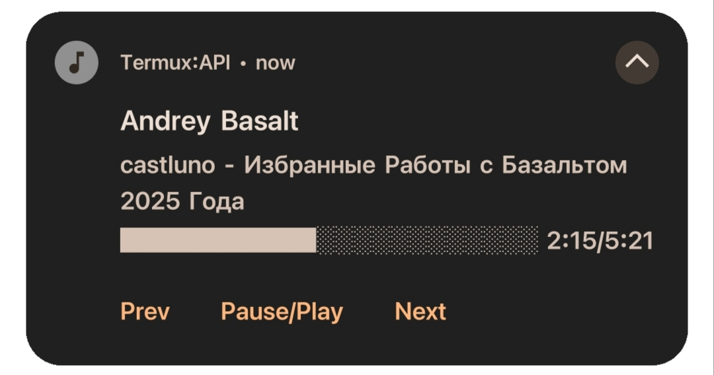

# cmus-notifier

background notification controller for cmus in Termux.

the repository has moved to gitlab. the license is now GPLv3. there will be no further updates on GitHub.

##### license
GPLv3

